## Praktikum 4 : CSS Layout ##

Berikut hasil dari praktikum saya pada praktikum 4 : CSS Layout

## Dokumen HTML

Pada tahap pertama, dibuat file HTML dengan nama lab4_box.html.

## Box Element

Setelah struktur HTML selesai, ditambahkan tiga elemen `
` di dalam elemen `<section>`. Setiap elemen diberi class yang berbeda, yaitu div1, div2, dan div3, dengan teks Div 1, Div 2, dan Div 3.
Elemen `
` digunakan sebagai kotak untuk mempelajari cara menyusun elemen pada halaman web. Setiap kotak kemudian dapat diberikan warna dan pengaturan tampilan menggunakan CSS.

## CSS Float Property & Clearfix Element

Pada tahap ini, ditambahkan deklarasi CSS pada bagian `<head>` untuk mengatur tampilan elemen kotak. Properti float: left digunakan agar kotak bergerak ke sisi kiri dan dapat tersusun berdampingan. Properti padding: 10px ditambahkan untuk memberikan ruang di dalam kotak. Warna setiap kotak dibedakan menggunakan background merah pada div1, kuning pada div2, dan hijau pada div3. Setelah kode CSS ditambahkan, halaman dibuka melalui browser untuk melihat perubahan tampilannya.
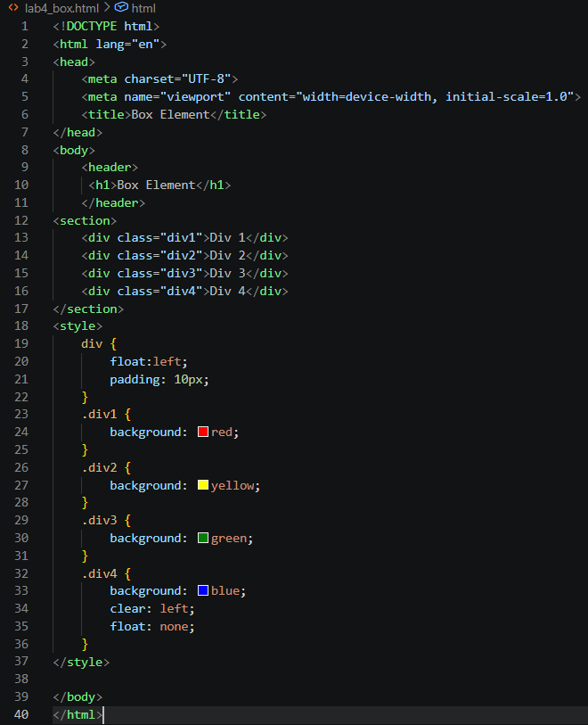
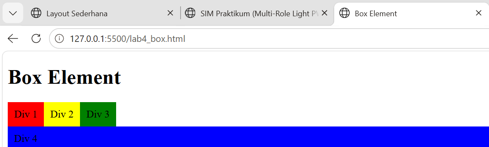

## Lampiran praktikum
 
Home/Layout sederhana :
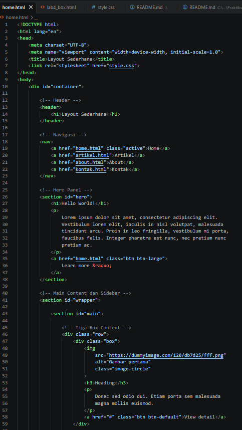
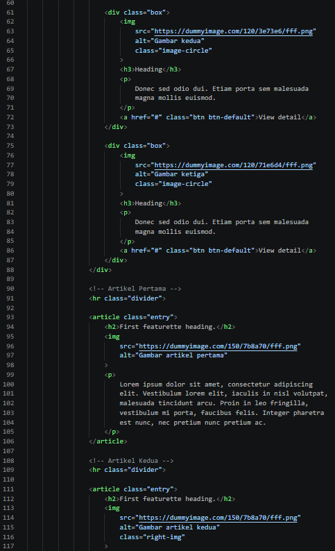
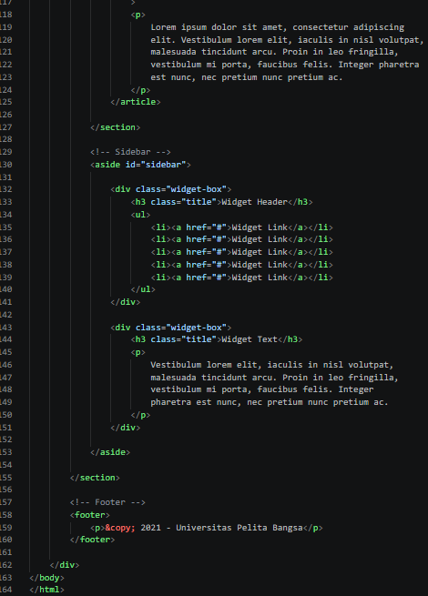
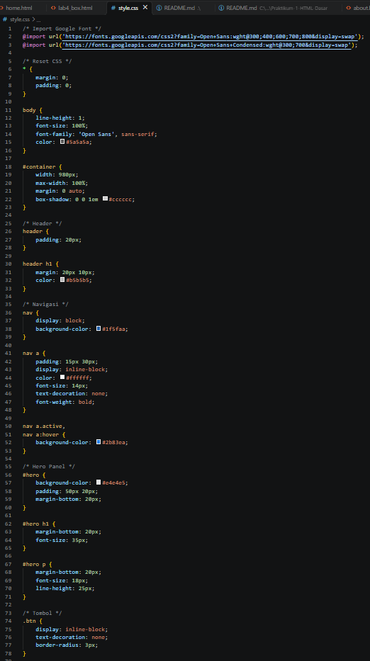
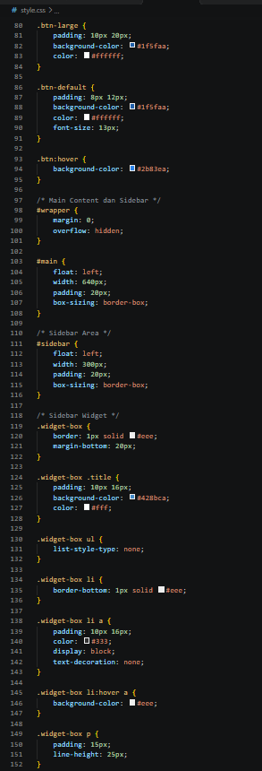
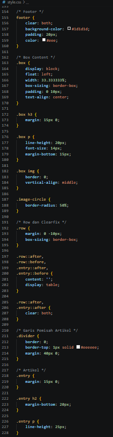
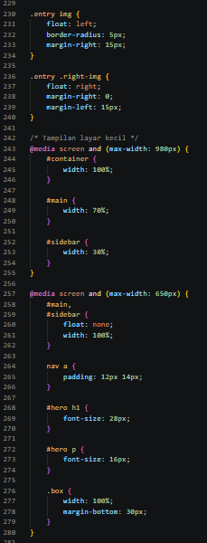
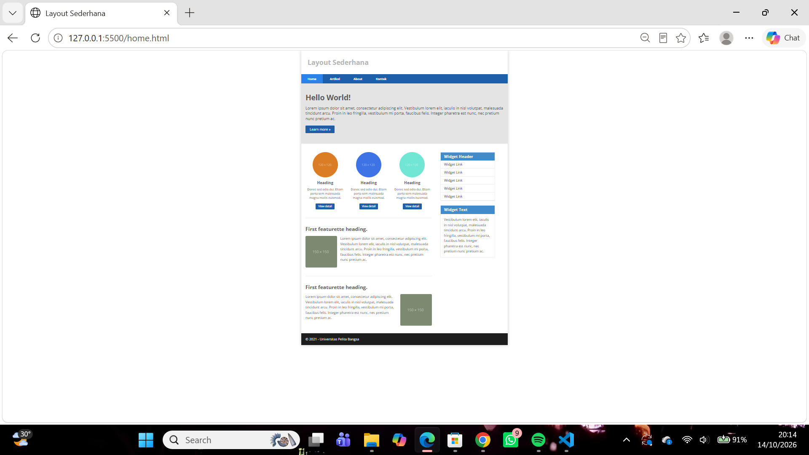

About :
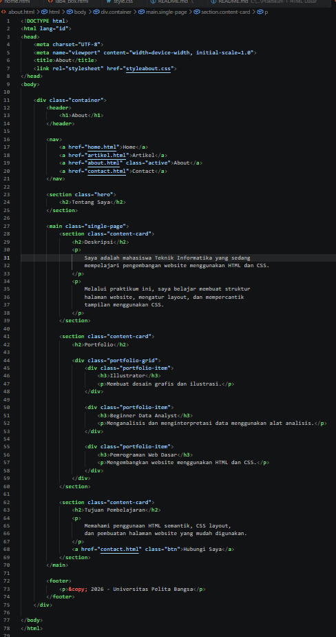
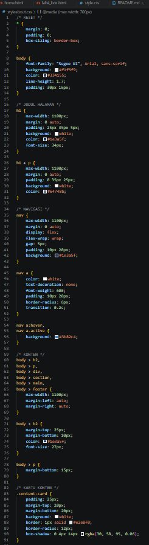
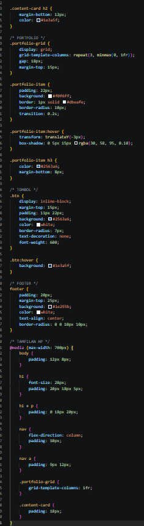
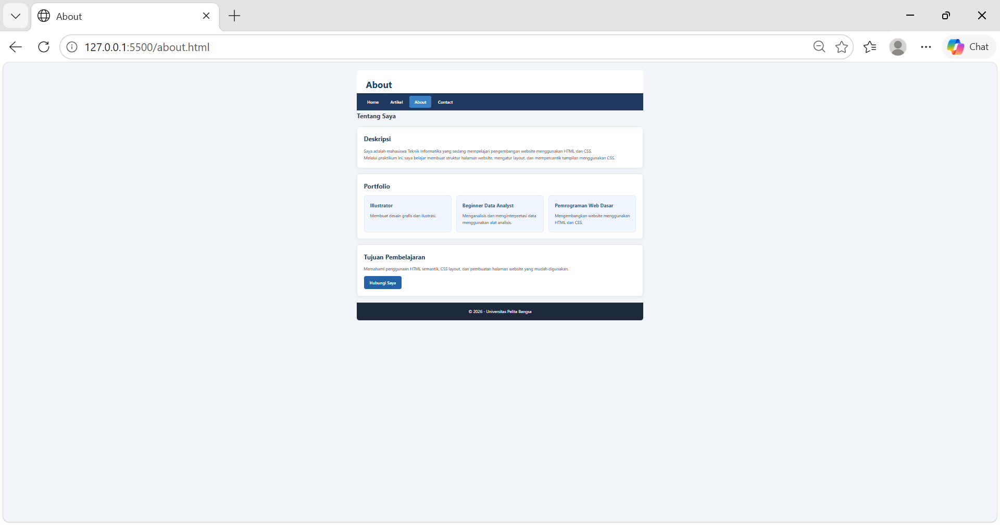

Contact :
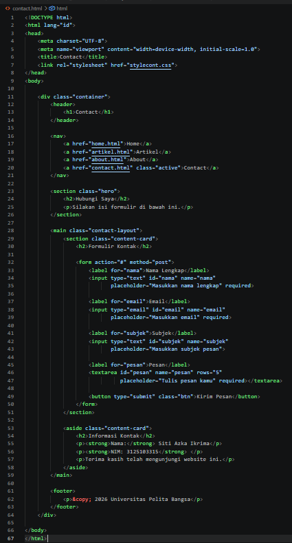
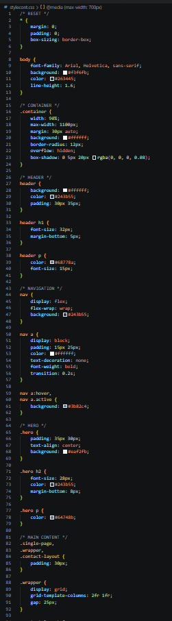
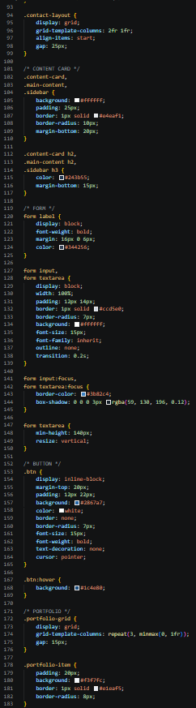
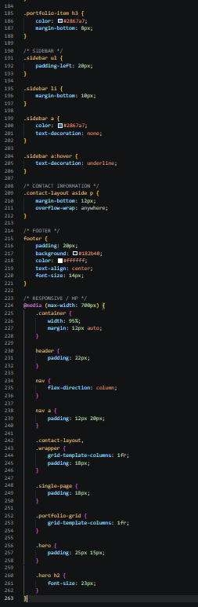
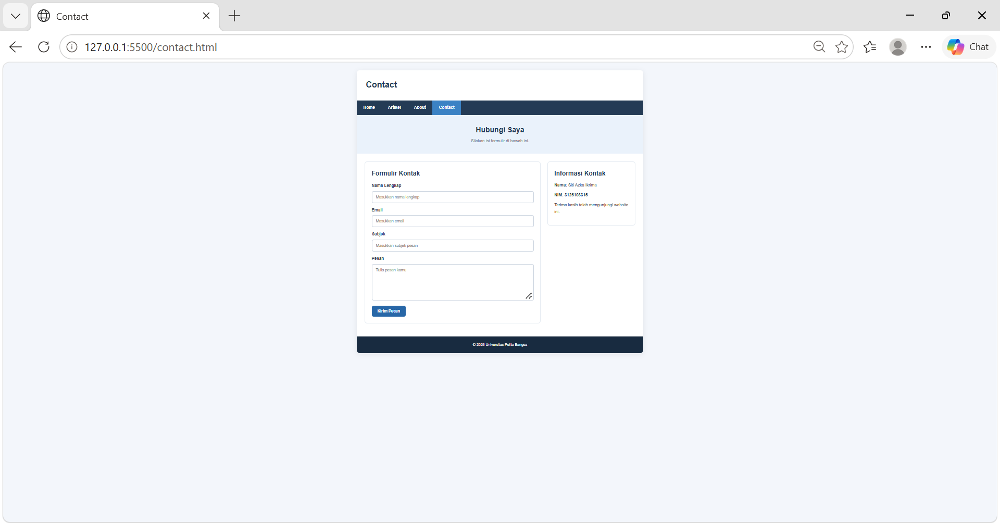